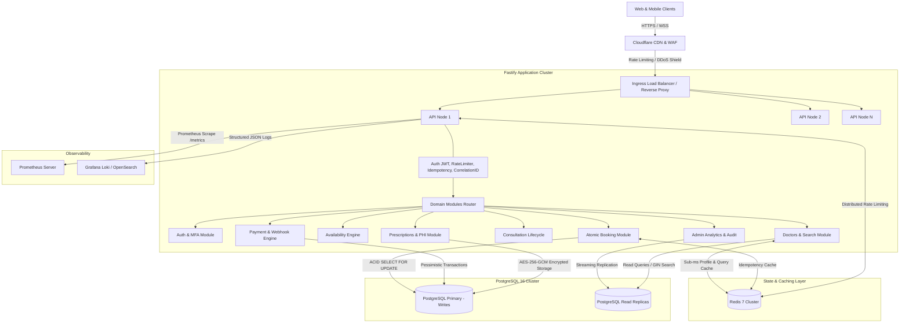
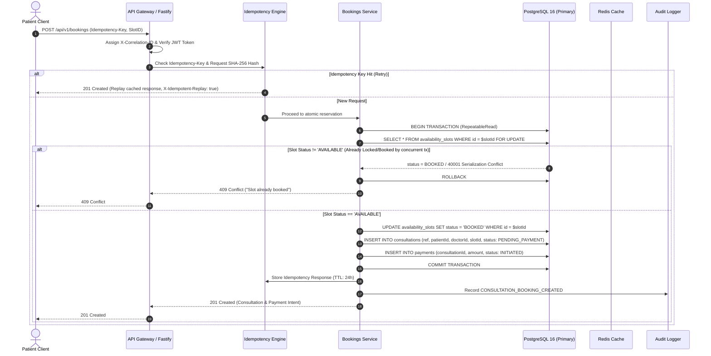
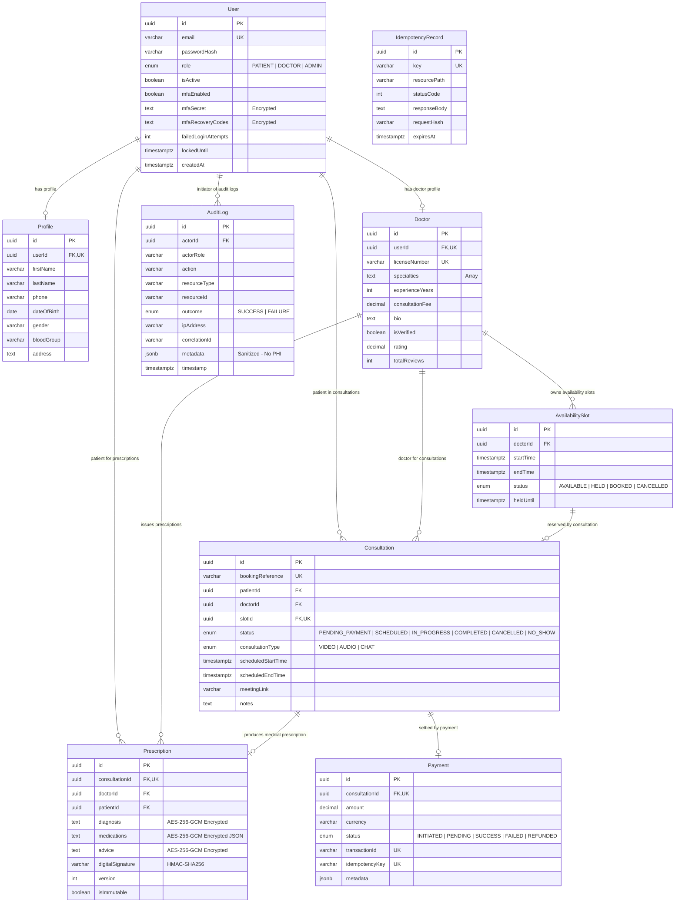

# Amrutam Telemedicine Backend — Architecture & System Design Document

**Author:** Amrutam Engineering Architecture Team  
**System Target:** 100,000 daily consultations | p95 Read < 200ms | p95 Write < 500ms | 99.95% Availability  
**Version:** 1.0.0 (Production Grade)

---

## 1. Executive Summary & Architectural Overview

The Amrutam Telemedicine Backend is a high-throughput, security-first healthcare platform engineered to support over 100,000 daily patient consultations across India and globally. The system orchestrates end-to-end patient care: discovery of verified Ayurvedic doctors, non-overlapping availability slot management, race-condition-safe atomic booking, consultation lifecycle management, AES-256-GCM encrypted electronic medical records (prescriptions/PHI), and idempotent webhook payment reconciliation.

Built on **Node.js 22 LTS, TypeScript (strict mode), Fastify v5, PostgreSQL 16, and Redis 7**, the architecture guarantees sub-millisecond in-memory caching, pessimistic row-level locking for zero double-booking, and continuous audit trails for regulatory compliance (DISHA, HIPAA, and GDPR alignment).

---

## 2. High-Level Architecture & Data Flow

---

## 3. Booking Flow Sequence Diagram (Atomic Concurrency)

The diagram below details the atomic reservation protocol. To prevent race conditions and double bookings under concurrent spikes, the system employs PostgreSQL pessimistic row-level locking (`SELECT ... FOR UPDATE`) in an isolated transaction alongside idempotency deduplication.

---

## 4. Entity-Relationship Diagram (ERD)

The data model enforces relational integrity, explicit foreign key cascades, unique constraints, and strict data types.

---

## 5. Retry, Backoff & Resilience Strategy

For interactions spanning payment gateways, notification dispatch, and network calls, blind retries can cause cascade storms and duplicate financial transactions. The following deterministic policies are enforced:

1. **Transient Network Errors (PostgreSQL Connection Drops, Redis Timeouts)**:
   - Strategy: Full Jitter Exponential Backoff.
   - Formula: $t_{\text{sleep}} = \min(t_{\text{max}}, t_{\text{base}} \times 2^{\text{attempt}}) \pm \text{random\_jitter}$
   - Parameters: $t_{\text{base}} = 100\,\text{ms}$, $t_{\text{max}} = 3000\,\text{ms}$, max attempts = 3.
2. **Permanent Failures**:
   - HTTP 400 (Validation), 401 (Unauthorized), 403 (Forbidden), 404 (Not Found), 422 (Unprocessable) are **NEVER retried**.
3. **Idempotency Safeguard**:
   - Every retryable write operation requires an `Idempotency-Key` header.
   - If a retry arrives with an identical key and identical request body, the cached status and payload are immediately replayed with `X-Idempotent-Replay: true`.
   - If an idempotency key is reused with a different request payload, the request is immediately rejected with `422 Unprocessable Entity` to prevent state corruption.

---

## 6. Data Partitioning & Sharding Strategy (100k Daily Scale)

To sustain 100,000 consultations daily (36.5 million consultations and audit records annually):

1. **Time-Based Range Partitioning on `consultations` and `audit_logs`**:
   - Tables are partitioned by month: `consultations_y2026m10`, `consultations_y2026m11`, etc.
   - Queries spanning recent consultations automatically prune historical partitions via PostgreSQL partition pruning (`enable_partition_pruning = on`).
2. **Hot vs Cold Storage Tiering**:
   - Consultations older than 180 days are migrated to cold storage read-only tablespaces or compressed Parquet archives on S3/GCS.
   - Active doctor search and slot availability utilize Redis in-memory caching with a 60-second TTL and write-through invalidation upon booking.
3. **Index Optimization**:
   - Composite B-Tree index on `(doctorId, status, startTime)` for slot availability lookups.
   - Partial index: `CREATE INDEX idx_active_slots ON availability_slots (doctorId, startTime) WHERE status = 'AVAILABLE';`
   - GIN indexes for doctor specialty array search.

---

## 7. Caching & Concurrency Handling

| Component | Mechanism | Concurrency Guarantee | Invalidation Rule |
| :--- | :--- | :--- | :--- |
| **Doctor Profiles** | Redis Key-Value (`amrutam:doc:<id>`) | Read-through with 300s TTL | Immediate cache eviction on `PATCH /api/v1/doctors/me/profile`. |
| **Search Queries** | Redis Key-Value with hashed query parameters | 60s TTL for hot queries | TTL expiration; read replicas for dynamic long-tail queries. |
| **Slot Reservation** | PostgreSQL Row-Level Lock (`SELECT ... FOR UPDATE`) | Mutual exclusion at DB engine level | Row status transitioned to `BOOKED` within ACID transaction boundary. |
| **Idempotency** | PostgreSQL `idempotency_records` + Redis lock | Atomicity across network retries | 24-hour expiration timestamp. |

---

## 8. Transaction Boundaries & Saga Decisions

- **Single System Transactions (ACID)**:
  - Booking creation and slot reservation are strictly co-located in a single PostgreSQL transaction (`RepeatableRead` isolation level). If any sub-step fails (e.g. payment record initialization), the slot update rolls back instantly.
- **Distributed Payment Webhook Processing**:
  - Payment reconciliation follows an asynchronous Event-Driven State Pattern:
    1. Patient initiates booking -> consultation created in `PENDING_PAYMENT` state.
    2. Payment Gateway collects funds asynchronously.
    3. Payment Gateway calls webhook with HMAC signature (`x-amrutam-signature`).
    4. Webhook handler verifies signature, checks event deduplication, and within an ACID transaction updates `payment.status = SUCCESS` and `consultation.status = SCHEDULED`.
    5. If payment fails or expires, a background reaper frees the held slot back to `AVAILABLE`.

---

## 9. Backup and Disaster Recovery (DR) Strategy

- **Recovery Point Objective (RPO)**: < 5 minutes.
- **Recovery Time Objective (RTO)**: < 30 minutes.
- **Continuous Archival**:
  - PostgreSQL Write-Ahead Logging (WAL-G / pgBackRest) streaming WAL segments continuously to redundant geo-distributed object storage (AWS S3 Glacier / GCP Cloud Storage).
- **Daily Backups**:
  - Full automated physical snapshot daily at 02:00 UTC with automated restoration dry-run testing in an isolated staging environment.
- **Point-in-Time Recovery (PITR)**:
  - Supports restoring the database to any millisecond within the past 30 days in case of catastrophic corruption or accidental deletion.
- **High Availability Topology**:
  - Multi-AZ deployment with Patroni / AWS RDS Multi-AZ synchronous replication and automatic failover (< 60 seconds).
