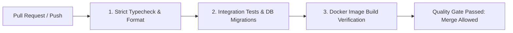

# GitHub Actions CI/CD Pipeline & Branch Protection Specification

**Repository:** `Health-System` (Amrutam Telemedicine Backend)  
**Target Protected Branch:** `main`

---

## 1. Overview of Automated CI/CD Pipeline

The Amrutam engineering workflow enforces continuous integration quality gates on all pull requests and pushes to `main`. Every code change must pass four mandatory pipeline stages before it can be merged into production:



### Stage 1: Strict Typecheck & Code Hygiene (`typecheck-and-lint`)
- Runs `npx prisma generate` to build Prisma client types.
- Executes `npm run typecheck` under strict TypeScript (`noImplicitAny`, `strictNullChecks`).
- Validates code formatting via `prettier --check`.

### Stage 2: Automated Tests & Coverage Gates (`test-and-coverage`)
- Spins up isolated GitHub Actions service containers:
  - `postgres:16-alpine` (healthcheck via `pg_isready`)
  - `redis:7-alpine` (healthcheck via `redis-cli ping`)
- Deploys database migrations: `npx prisma migrate deploy`.
- Executes full test suite with coverage thresholds:
  - Unit Tests
  - Integration Tests
  - Concurrency Tests (`SELECT ... FOR UPDATE` race-condition verification)
  - Security & BOLA Tests
  - Contract & Observability Tests
- Uploads test coverage artifact (`coverage/`).

### Stage 3: Container Build Verification (`docker-build`)
- Compiles the multi-stage production `Dockerfile` with non-root security runner.
- Validates that the container image builds without errors.

---

## 2. GitHub Branch Protection Rules for `main`

To prevent regressions, unauthorized code changes, or direct pushes to `main`, configure the following GitHub repository settings under **Settings > Branches > Branch protection rules > Add rule**:

### Branch Pattern: `main`

| Setting | Configuration Value | Rationale |
| :--- | :--- | :--- |
| **Require a pull request before merging** | **Enabled** | Prevents direct pushes to production branch. All changes must enter via a reviewed PR. |
| **Require approvals** | **1 approval minimum** | Enforces peer code review standards. |
| **Dismiss stale pull request approvals when new commits are pushed** | **Enabled** | Re-triggers review if the PR author pushes additional changes after receiving approval. |
| **Require status checks to pass before merging** | **Enabled** | Guarantees code builds and passes all tests before merge is unlocked. |
| **Status checks that are required** | - `Strict Typecheck & Code Hygiene`<br>- `Automated Test Suite & Coverage Gates`<br>- `Container Build Verification` | Blocks merging if any CI job fails. |
| **Require branches to be up to date before merging** | **Enabled** | Ensures code is tested against the latest `main` commit. |
| **Require linear history** | **Enabled** | Keeps Git history clean and bisectable (Squash & Merge or Rebase). |
| **Do not allow bypassing the above settings** | **Enabled** | Enforces rules even for repository administrators. |
| **Allow force pushes** | **Disabled** | Prevents history rewrites or accidental deletion of `main`. |
| **Allow deletions** | **Disabled** | Prevents deletion of the production `main` branch. |

---

## 3. Pull Request Checklist for Engineers

Before submitting a Pull Request for review:
1. Ensure all new features have accompanying unit or integration tests in `tests/`.
2. Run local verification:
   ```bash
   npm run typecheck
   npm run format:check
   npm test
   ```
3. Verify that database migrations are included in `prisma/migrations/` if the schema changed.
4. Ensure no secrets, tokens, or personal `.env` files are tracked in Git.
