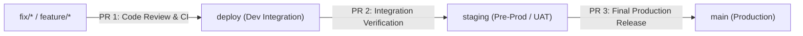
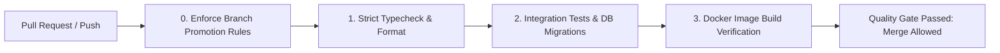

# GitHub Actions CI/CD Pipeline & Branch Protection Specification

**Repository:** `Health-System` (Amrutam Telemedicine Backend)  
**Target Protected Branch:** `main`

---

## 1. Multi-Stage Branch Promotion Architecture

In adherence with enterprise release standards, changes progress sequentially across isolated deployment tiers:



1. **Feature / Fix Branches (`feature/*`, `fix/*`):** Short-lived working branches where engineers build and test discrete changes.
2. **`deploy` Branch:** First deployment tier. Integrates new features and triggers continuous deployment to the development/testing cluster.
3. **`staging` Branch:** Mirrors production configuration. Used for end-to-end integration tests, load benchmark validation, and stakeholder UAT.
4. **`main` Branch:** Protected production branch representing the live, audited system. Every merge creates a tagged production release.

---

## 2. Overview of Automated CI/CD Pipeline

The Amrutam engineering workflow enforces continuous integration quality gates on all pull requests and pushes to `main`. Every code change must pass four mandatory pipeline stages before it can be merged into production:



### Stage 0: Enforce Branch Promotion Rules (`enforce-branch-rules`)
- Validates the base and head branch of every pull request:
  - **`main` Target:** Strictly requires source branch to be `staging`. Fails with error if any other branch targets `main`.
  - **`staging` Target:** Strictly requires source branch to be `deploy`. Fails with error if any other branch targets `staging`.
- Prevents bypasses by running as the first required status check before downstream jobs execute.

### Stage 1: Strict Typecheck & Code Hygiene (`typecheck-and-lint`)
- Runs `npx prisma generate` to build Prisma client types.
- Executes `npm run typecheck` under strict TypeScript (`noImplicitAny`, `strictNullChecks`).
- Validates code formatting via `prettier --check`.

### Stage 2: Automated Tests & Coverage Gates (`test-and-coverage`)
- Spins up isolated GitHub Actions service containers:
  - `postgres:16-alpine` (healthcheck via `pg_isready`)
  - `redis:7-alpine` (healthcheck via `redis-cli ping`)
- Deploys database migrations: `npx prisma migrate deploy`.
- Executes full test suite with coverage thresholds:
  - Unit Tests
  - Integration Tests
  - Concurrency Tests (`SELECT ... FOR UPDATE` race-condition verification)
  - Security & BOLA Tests
  - Contract & Observability Tests
- **Blocking Gate:** If any test fails or coverage drops below thresholds, the step exits with code 1, immediately failing the status check and blocking merge.
- Uploads test coverage artifact (`coverage/`).

### Stage 3: Container Build Verification (`docker-build`)
- Compiles the multi-stage production `Dockerfile` with non-root security runner.
- Validates that the container image builds without errors.

---

## 3. GitHub Branch Protection Rules

To enforce that merges are blocked if any test fails and that only the designated promotion branch can be merged, configure the following rules under **Settings > Branches > Branch protection rules**:

### Rule 1: Production Branch (`main`)
- **Target:** `main`
- **Allowed Source Branch:** Strictly `staging` (enforced via `enforce-branch-rules` check)
- **Require a pull request before merging:** Enabled (1 review required)
- **Dismiss stale pull request approvals:** Enabled
- **Require status checks to pass before merging:** Enabled
  - `Enforce Branch Promotion Rules`
  - `Strict Typecheck & Code Hygiene`
  - `Automated Test Suite & Coverage Gates`
  - `Container Build Verification`
- **Require branches to be up to date before merging:** Enabled
- **Require linear history:** Enabled (Squash or Rebase merge)
- **Do not allow bypassing the above settings:** Enabled
- **Allow force pushes:** Disabled

### Rule 2: Staging Branch (`staging`)
- **Target:** `staging`
- **Allowed Source Branch:** Strictly `deploy` (enforced via `enforce-branch-rules` check)
- **Require a pull request before merging:** Enabled
- **Require status checks to pass before merging:** Enabled
  - `Enforce Branch Promotion Rules`
  - `Strict Typecheck & Code Hygiene`
  - `Automated Test Suite & Coverage Gates`
  - `Container Build Verification`
- **Allow force pushes:** Disabled

---

## 3. Pull Request Checklist for Engineers

Before submitting a Pull Request for review:
1. Ensure all new features have accompanying unit or integration tests in `tests/`.
2. Run local verification:
   ```bash
   npm run typecheck
   npm run format:check
   npm test
   ```
3. Verify that database migrations are included in `prisma/migrations/` if the schema changed.
4. Ensure no secrets, tokens, or personal `.env` files are tracked in Git.
