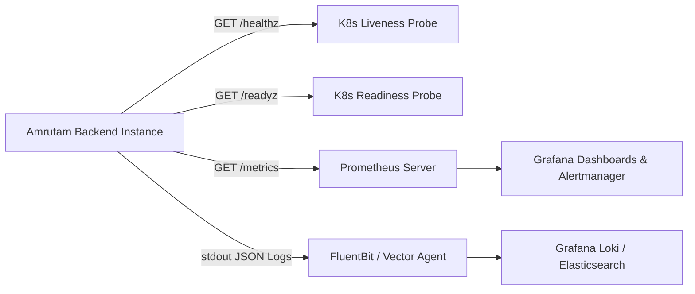

# Amrutam Telemedicine Backend — Operations & Observability Runbook

**Environment Target:** Production Kubernetes / ECS / Container Cluster  
**Platform SRE Guide:** Telemedicine Operations, Metrics, Alerting & Incident Response

---

## 1. Observability Architecture Overview

The Amrutam Telemedicine Backend exposes a three-pillar observability framework:
1. **Metrics**: Prometheus instrumentation via `/metrics` endpoint collecting standard runtime statistics and custom domain counters/histograms.
2. **Logs**: Structured JSON logging powered by Pino with automatic sensitive field redaction (`[REDACTED]`) and distributed correlation tracing (`X-Correlation-Id`).
3. **Probes**: Kubernetes-native liveness (`/healthz`) and readiness (`/readyz`) probes verifying upstream database and Redis cluster connectivity.



---

## 2. Health & Readiness Probes

### Liveness Probe (`GET /healthz`)
- **Purpose**: Checks whether the Node.js event loop and HTTP server are responsive.
- **Response**: `200 OK`
```json
{
  "status": "UP",
  "uptimeSeconds": 1420.45,
  "timestamp": "2026-10-19T16:45:00.000Z"
}
```

### Readiness Probe (`GET /readyz`)
- **Purpose**: Verifies that active connections to PostgreSQL (`SELECT 1`) and Redis (`PING`) are healthy before routing traffic.
- **Success Response**: `200 OK`
```json
{
  "status": "READY",
  "timestamp": "2026-10-19T16:45:00.000Z",
  "dependencies": {
    "database": "HEALTHY",
    "redis": "HEALTHY"
  }
}
```
- **Failure Response**: `503 Service Unavailable` (K8s immediately stops routing ingress traffic until recovery).

---

## 3. Prometheus Metrics Catalog

| Metric Name | Type | Labels | Description / SLA Alert Rule |
| :--- | :--- | :--- | :--- |
| `amrutam_http_request_duration_seconds` | Histogram | `method`, `route`, `status_code` | Latency distribution of HTTP requests. Alert if p95 > 200ms on reads or > 500ms on writes for 5 minutes. |
| `amrutam_consultation_bookings_total` | Counter | `status` | Cumulative consultation bookings created. Tracks booking volume. |
| `amrutam_prescriptions_issued_total` | Counter | None | Cumulative digital prescriptions issued by doctors. |
| `amrutam_payment_transactions_total` | Counter | `status`, `provider` | Cumulative payment webhook resolutions (`SUCCESS`, `FAILED`). |
| `amrutam_active_availability_slots` | Gauge | None | Real-time gauge of open availability slots across all doctors. |
| `amrutam_nodejs_heap_size_used_bytes` | Gauge | None | Node.js V8 memory utilization. Alert if > 85% of container limit. |

### Key Prometheus Query Examples

```promql
# 1. 95th Percentile Read Latency (SLA: < 200ms)
histogram_quantile(0.95, sum(rate(amrutam_http_request_duration_seconds_bucket{method="GET"}[5m])) by (le)) * 1000

# 2. 95th Percentile Write Latency (SLA: < 500ms)
histogram_quantile(0.95, sum(rate(amrutam_http_request_duration_seconds_bucket{method=~"POST|PATCH|PUT"}[5m])) by (le)) * 1000

# 3. Overall HTTP Error Rate Percentage
(sum(rate(amrutam_http_request_duration_seconds_count{status_code=~"5.."}[5m])) / sum(rate(amrutam_http_request_duration_seconds_count[5m]))) * 100

# 4. Hourly Booking Rate
sum(increase(amrutam_consultation_bookings_total[1h]))
```

---

## 4. Incident Response Runbooks

### Runbook 1: PostgreSQL Connection Pool Saturation
- **Symptom**: `/readyz` returns 503; logs report `PrismaClientInitializationError: Timed out fetching a new connection from the connection pool`.
- **Diagnosis**:
  1. Inspect active connections:
     ```sql
     SELECT count(*), state FROM pg_stat_activity GROUP BY state;
     ```
  2. Check for long-running idle transactions:
     ```sql
     SELECT pid, now() - xact_start AS duration, query FROM pg_stat_activity WHERE state <> 'idle' ORDER BY duration DESC;
     ```
- **Remediation**:
  1. Increase `DATABASE_POOL_MAX` in environment variables if database memory permits.
  2. Enable PgBouncer connection pooler in transaction pooling mode.
  3. Terminate stuck transaction: `SELECT pg_terminate_backend(<pid>);`

### Runbook 2: High Rate of Booking Concurrency Conflicts (HTTP 409)
- **Symptom**: Spike in 409 Conflict responses on `POST /api/v1/bookings`.
- **Diagnosis**: Multiple patients are attempting to reserve the exact same doctor slot simultaneously (e.g. celebrity Ayurvedic doctor campaign).
- **Remediation**:
  - This is expected system behavior protecting data integrity (zero double-booking).
  - Verify client application is handling 409 by prompting the patient with alternative adjacent slots.
  - Scale doctor availability by encouraging doctors to open additional parallel consultation slots.

### Runbook 3: Payment Webhook Signature Failures (HTTP 401)
- **Symptom**: Webhook handler returns 401 Unauthorized for incoming payment provider calls.
- **Diagnosis**:
  1. Verify if `PAYMENT_WEBHOOK_SECRET` has been rotated recently.
  2. Inspect raw webhook payload for encoding/newline discrepancies.
- **Remediation**:
  - Re-synchronize the webhook signing secret with the payment provider portal.
  - Check correlation ID logs in Grafana Loki: `{app="amrutam"} |= "Invalid webhook signature"`.
