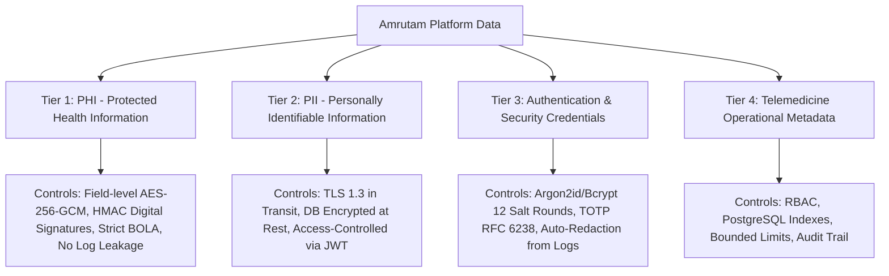

# Amrutam Telemedicine Backend — Security Checklist & Threat Model

**Security Standard Compliance:** OWASP Top 10 (2021), DISHA (Digital Information Security in Healthcare Act), HIPAA Security Rule Alignment  
**Document Classification:** Internal Technical Security Architecture

---

## 1. Threat Modeling (STRIDE Methodology)

| Threat Category | Potential Attack Vector | System Vulnerability | Amrutam Mitigation | Verified In Code / Tests |
| :--- | :--- | :--- | :--- | :--- |
| **Spoofing** | Adversary impersonates a patient or doctor using stolen credentials or session hijacking. | Weak authentication or predictable session IDs. | - Argon2id / bcrypt (12 salt rounds) password hashing. - RFC 6238 TOTP Multi-Factor Authentication with backup recovery codes. - Short-lived signed JWT access tokens (15m) + secure refresh tokens. - Account lockout after 5 consecutive failed login attempts. | `tests/unit/totp.test.ts` `tests/integration/auth.integration.test.ts` |
| **Tampering** | Malicious actor modifies medical diagnosis or medication prescription en route or in DB. | Unsigned records, lack of field encryption. | - Field-level **AES-256-GCM** authenticated encryption for all PHI (diagnosis, medications, advice). - HMAC-SHA256 digital signature computed from doctor credentials and prescription body. - Prescriptions are marked immutable (`isImmutable: true`, `version: 1`). | `tests/unit/crypto.test.ts` `tests/integration/prescriptions.integration.test.ts` |
| **Repudiation** | Doctor denies issuing a prescription, or patient denies booking a consultation. | Absence of audit logs and actor tracking. | - Dedicated immutable `audit_logs` table recording `actorId`, `actorRole`, `action`, `resourceId`, timestamp, `ipAddress`, and `correlationId`. - Non-repudiation ensured via cryptographic digital signatures on prescriptions. | `tests/integration/prescriptions.integration.test.ts` `src/shared/security/audit.service.ts` |
| **Information Disclosure** | Data breach exposing sensitive patient medical history (PHI) or unauthorized API access. | Broken Object-Level Authorization (BOLA / IDOR) or unencrypted DB dumps. | - Server-side Object-Level Authorization: patients can only access their own records; doctors can only access their assigned patients. - AES-256-GCM field encryption at rest. - Sensitive metadata redaction in Pino logger (`password`, `token`, `diagnosis`, `medications`). | `tests/security/access-control.test.ts` `tests/integration/prescriptions.integration.test.ts` |
| **Denial of Service** | Botnet floods booking endpoints, causing database lock starvation or API unresponsiveness. | Unbounded database queries, lack of rate limits. | - Distributed token-bucket rate limiting via `@fastify/rate-limit` (120 req/min for general API, 10 req/min for auth). - Hard caps on pagination (`limit` strictly capped at 50 to 100). - Pessimistic lock timeout capped at 10 seconds. | `tests/contract/openapi-contract.test.ts` `src/app/create-app.ts` |
| **Elevation of Privilege** | Normal patient invokes doctor slot creation or administrative analytics endpoints. | Missing or client-side role authorization checks. | - Server-side RBAC middleware (`requireRoles([UserRole.DOCTOR])`, `requireRoles([UserRole.ADMIN])`) applied as Fastify `preHandler` hooks. - JWT claims verified cryptographically on every protected request. | `tests/security/access-control.test.ts` |

---

## 2. Healthcare Data Classification

Data within the Amrutam platform is strictly categorized into 4 tiers with tailored protection controls:

### Tier 1: Protected Health Information (PHI)
- **Data Elements**: Consultation notes, medical diagnosis, prescribed medications, dosage instructions, clinical advice.
- **Protection**: AES-256-GCM authenticated encryption at rest with separate 256-bit key; HMAC-SHA256 digital signature; strictly redacted from Pino logger and error payloads; object-level authorization guards.

### Tier 2: Personally Identifiable Information (PII)
- **Data Elements**: Full name, email address, phone number, date of birth, gender, blood group, emergency contact.
- **Protection**: TLS 1.3 in transit; encrypted storage volumes (LUKS / EBS KMS); role-based visibility.

### Tier 3: Security & Auth Credentials
- **Data Elements**: Password hashes, JWT secrets, MFA TOTP secrets, recovery codes, payment webhook signing secrets.
- **Protection**: Bcrypt salt rounds = 12; TOTP secrets encrypted with AES-256-GCM; recovery codes single-use burned; secrets strictly injected via environment variables (never committed to repository).

### Tier 4: Operational & Telemedicine Metadata
- **Data Elements**: Doctor availability slots, consultation booking references, payment status, HTTP request durations.
- **Protection**: PostgreSQL row-level locks, audit logging, rate limiting.

---

## 3. OWASP Top 10 (2021) Verification Checklist

| Vulnerability | Implemented Mitigation & Code Location | Verified In Automated Tests |
| :--- | :--- | :--- |
| **A01: Broken Access Control** | Explicit server-side RBAC (`requireRoles`) and object-level ownership checks (`consultation.patientId === request.user.userId`). | `tests/security/access-control.test.ts` (Passed) |
| **A02: Cryptographic Failures** | AES-256-GCM authenticated encryption, SHA-256 request hashing, HMAC-SHA256 webhook signatures, bcrypt password hashing. | `tests/unit/crypto.test.ts` (Passed) |
| **A03: Injection** | Parameterized SQL queries via Prisma ORM and typed raw SQL `$queryRaw` statements with explicit typecasts. Zero string concatenation in SQL. | `tests/integration/concurrency-booking.test.ts` (Passed) |
| **A04: Insecure Design** | Atomic slot reservation using database-level `SELECT ... FOR UPDATE` locks. Idempotency middleware preventing duplicate billing. | `tests/integration/concurrency-booking.test.ts` `tests/integration/idempotency.integration.test.ts` (Passed) |
| **A05: Security Misconfiguration** | Helmet security headers (CSP, HSTS, X-Content-Type-Options, X-Frame-Options), CORS restrictions, non-root Docker runner. | `tests/contract/openapi-contract.test.ts` `Dockerfile` |
| **A06: Vulnerable Components** | Minimal dependencies, dependabot scanning, pinned action versions, Node 22 alpine. | `.github/workflows/ci.yml` |
| **A07: Identification & Auth** | Account lockout after 5 failed attempts, RFC 6238 TOTP MFA, constant-time password comparisons. | `tests/integration/auth.integration.test.ts` (Passed) |
| **A08: Software & Data Integrity** | Webhook HMAC signature verification (`verifyHmacSignature`), doctor digital signature verification. | `tests/integration/payment-webhook.integration.test.ts` (Passed) |
| **A09: Logging & Monitoring** | Structured JSON logging with correlation IDs, Prometheus metrics, healthz/readyz probes, zero plaintext PHI in logs. | `src/config/logger.ts` `src/shared/security/audit.service.ts` |
| **A10: Server-Side Request Forgery**| Meeting links and webhook endpoints are strictly internally managed or validate destination domains. | `src/modules/payments/payments.service.ts` |

---

## 4. Key Management & Rotation Policy

1. **Master Data Encryption Key (`DATA_ENCRYPTION_KEY`)**:
   - 256-bit cryptographically secure key (64 hex characters) generated via `crypto.randomBytes(32)`.
   - Stored in AWS Secrets Manager / HashiCorp Vault.
   - Rotated annually with envelope encryption (DEK/KEK pattern) or dual-key decryption during transition windows.
2. **MFA Key (`MFA_ENCRYPTION_KEY`)**:
   - Encrypts user TOTP base32 seeds at rest using AES-256-GCM.
3. **Webhook Secret (`PAYMENT_WEBHOOK_SECRET`)**:
   - Rotated every 90 days with dual-signature verification support during rotation grace periods.
